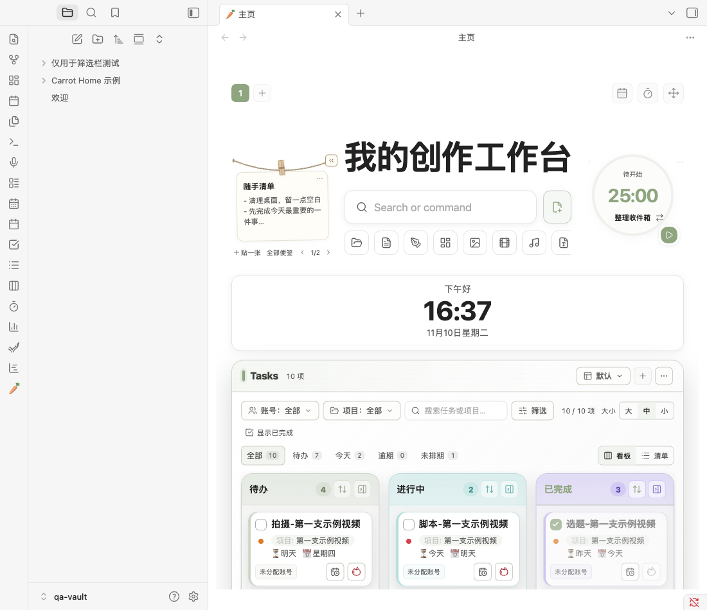
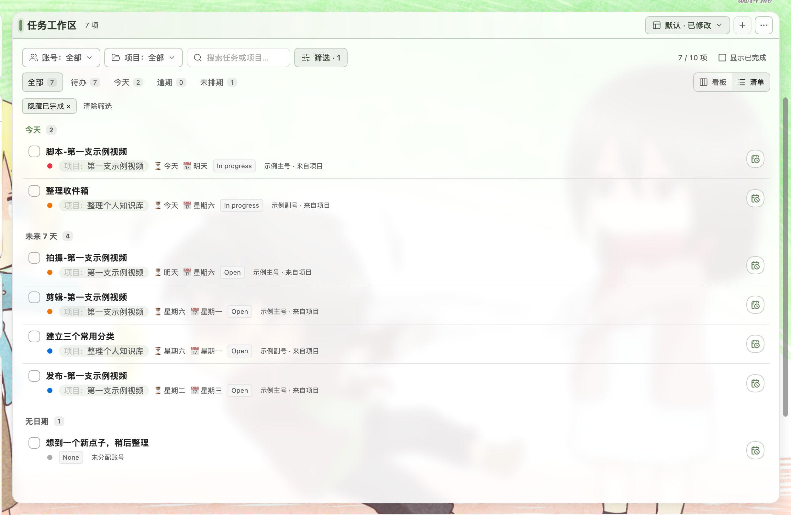

# 🥕 Carrot Home

**把今天的任务、项目进度和常用笔记，放在同一个 Obsidian 首页。**

Carrot Home 基于 [ondreu/Hearth](https://github.com/ondreu/Hearth) 定制，在首页中组合时钟、日历、书签、最近笔记、TaskNotes 任务工作区与 Carrot Gantt 项目甘特图。保留 Hearth 的来源说明与 MIT 版权声明。

[安装与更新](#安装与更新) · [效果展示](#效果展示) · [任务工作区详解](docs/tasks.md) · [最新 Release](https://github.com/carrot-tree/carrot-home/releases/latest)


> 配图来自 Obsidian 桌面端的独立演示库，使用虚构项目、任务和示例账号，不包含私人笔记或凭据。截图中的背景与布局经过演示配置，背景仅用于文档展示，不是插件默认背景。任务与甘特图分别需要独立安装 TaskNotes 和 Carrot Gantt。

## 能做什么

- **把常用内容放在首页**：搜索笔记、快速新建，查看时钟、日历、书签与最近笔记；背景和卡片布局可按自己的习惯调整。
- **按工作范围看任务**：按内容账号、项目、关键词、计划／截止日期、状态和优先级筛选，并保存常用视图。
- **看板与清单随时切换**：看板按状态组织任务，日期清单集中显示今天、逾期与接下来的安排。
- **从任务直接开始专注**：点击小番茄启动或继续 TaskNotes 番茄钟，保留当前任务关联与已有计时。
- **随手记录与整理便签**：顶部“随手晾晾”支持 Markdown 便签、编辑草稿、排序、收起和恢复。
- **在主页管理一轮专注**：“专注一刻”同步真实 TaskNotes 会话，支持选择任务、暂停、继续、安全结束与休息。
- **一起查看任务和项目进度**：通过独立的 Carrot Gantt 插件，在首页中查看项目时间轴和关联任务。

## 顶部工具

“随手晾晾”使用左侧留白，右边缘跟随下方左侧卡片；空间足够时并排显示两张，较窄时切换单张翻页。两个木夹向相反方向倾斜，向左收起后保留可展开的单圈绳。

“专注一刻”作为独立圆盘放在右上方，尺寸随可用空间调整。任务文字居中，旁边的小图标可快捷搜索、切换任务；结束与时长等操作保留在“…”菜单。向右收起后，真实倒计时胶囊停在右上方，点击即可展开，计时继续。

标题和搜索整组保持居中；快捷分类保持方形，间距在不同布局下动态调整，放不下时横向滚动。下方在720px可用宽度转为单列后，顶部两侧仍保留至600px，再切换紧凑入口；命令入口始终可用。圆盘缩小时围绕圆心定位，左侧晾绳、木夹和绳端按钮组成的图案上沿与圆盘上沿对齐。便签为真实 Markdown，排序、收起、草稿和专注选择使用独立 `top-area.json`，升级时保留已有文件。功能、兼容与验证范围见 [顶部工具说明](docs/top-area.md)。




统一设置入口：**设置 → Carrot Home → 顶部工具**；区域显示与恢复也可从主页原有右上角“更多选项（…）”菜单操作。

## 效果展示

### 日期清单：把任务和日期放在一起

用“全部／待办／今天／逾期／未排期”快速聚焦，再叠加账号或项目筛选。清单保留 TaskNotes 的状态、循环实例完成和日期编辑操作；任务行同时显示项目、日期、状态与账号。



### 项目甘特图：在首页查看排期

配合 [Carrot Gantt](https://github.com/carrot-tree/carrot-gantt)，将项目进度与任务时间轴嵌入同一页面。可查看关联任务、调整日期，并按项目状态筛选。甘特图为独立插件，Carrot Home 不包含其实现。


截图环境与说明见 [配图说明](docs/images/README.md)。

## 安装与更新

需要 **Obsidian 1.12.2 或更高版本**。已验证桌面端；手机尚未完成真机验收。

### 推荐：通过 BRAT

1. 在 Obsidian 社区插件中安装并启用 **BRAT**。
2. 打开 BRAT 设置，选择 **Add Beta plugin**，输入：

   ```text
   carrot-tree/carrot-home
   ```

3. 选择跟踪最新版本，添加后在社区插件列表启用 **Carrot Home**。
4. 从左侧功能区或命令面板打开 **Carrot Home**。

当前发布版本为 [2.1.4](https://github.com/carrot-tree/carrot-home/releases/tag/2.1.4)。BRAT 的自动检查开关决定是否自动检查更新；固定历史版本的条目不会跟随最新版。

### 按需安装配套插件

| 想使用的内容 | 需要安装或启用 |
| --- | --- |
| 任务看板、日期清单、任务日历 | 社区插件 **TaskNotes** |
| 项目甘特图 | **Carrot Gantt**，通过 BRAT 添加 `carrot-tree/carrot-gantt` |
| Dataview 查询卡片 | 社区插件 **Dataview**，按需启用其 JavaScript 查询 |
| 书签、白板、日记、录音 | 对应的 Obsidian 核心插件 |

推荐安装 TaskNotes 与 Carrot Gantt，以使用截图中的完整工作台。BRAT 安装 Carrot Home 时不会自动安装这些依赖，也不会修改它们的配置。

### 手动安装或回滚

从 [Releases](https://github.com/carrot-tree/carrot-home/releases/latest) 下载 **`main.js`、`manifest.json`、`styles.css`** 三个独立附件，放入 `.obsidian/plugins/carrot-home/`，然后重载插件。默认布局与虚构示例已内置，无需额外资源文件。

**升级前备份插件目录，保留已有 `data.json`。** 回滚时恢复旧版三个程序文件；仅在需要恢复显示偏好时使用对应的设置备份。不要通过卸载插件来切换仓库或更新版本。

## 第一次打开

新安装提供一个 Home 页面和六个板块。示例集中在 `Carrot Home 示例/`，包含 10 个虚构任务、3 个项目、1 条选题和使用说明，日期会设为首次创建时的当天附近。

- 可以自由修改、删除示例，或替换成自己的内容。
- 同路径已有笔记会被保留，重载不会补回已删除的示例。
- 已有 Carrot Home 配置的库继续使用原布局，升级时不自动添加示例，也不批量回写历史任务。
- 云日历、微信读书等可选服务需自行配置账号，公开代码与安装附件不包含作者的笔记、凭据或个人 `data.json`。

账号继承、多选筛选、常用视图、日期分组与滚动行为详见 [Tasks 工作区使用说明](docs/tasks.md)。

## Hearth 来源与许可

Carrot Home 是 [Hearth](https://github.com/ondreu/Hearth) 的定制发行版，本仓库保留 GitHub Fork 关系。感谢 [ondreu](https://github.com/ondreu) 提供的原始项目；保留上游 `Copyright (c) 2026 ondreu`、MIT 许可证及原有 manifest 署名。

此发行版由 [carrot-tree](https://github.com/carrot-tree) 维护。许可与署名说明见 [LICENSE](LICENSE) 和 [NOTICE.md](NOTICE.md)。TaskNotes、Dataview 与 Carrot Gantt 均为独立插件。

<details>
<summary>从旧仓库迁移的说明</summary>

本仓库由已 Fork 的 `carrot-tree/carrothome` 改名而来。旧独立仓库保留在 [carrot-home-legacy](https://github.com/carrot-tree/carrot-home-legacy)，旧 Release 与 Issue 等记录仍属于旧仓库；[1.1.3 附件](https://github.com/carrot-tree/carrot-home-legacy/releases/tag/1.1.3)也保留在那里。

已有 BRAT 条目若跟踪 `carrot-tree/carrot-home`，现在会指向这个 Fork。固定旧版本的条目无法在这里找到旧 Release，请根据需要切换到最新版本或明确选择 2.0.5；已有库的配置不会因此被自动修改。

</details>

<details>
<summary>开发与发布</summary>

`src/home-base.js` 保留原有 Home 运行代码；`src/tasks-workspace.js` 提供 Tasks 工作区与番茄钟入口；`src/modal-style.js` 统一 Home 自有弹框；`src/brat-bootstrap.js` 提供分享版初始化逻辑。`resources/` 只包含经过整理的默认布局和虚构示例。

使用 Node.js 22 或以上：

```sh
node scripts/build-runtime.cjs
node --check main.js
node scripts/verify-release.cjs
node --test tests/*.test.cjs
```

构建将默认资源嵌入 `main.js`。测试在内存中覆盖新安装、升级、重载、文件保留和初始化失败重试，不访问真实笔记库。

发布新版需同步 `manifest.json`、`versions.json`、`resources/defaults.json` 的 `lastSeenVersion`、`CHANGELOG.md` 和 `RELEASE_NOTES.md`，重新构建并提交，再运行 **Actions → Release plugin** 或推送对应版本标签。标签与 manifest 版本一致，例如 `2.0.5`，不加 `v` 前缀；工作流验证后上传三个 BRAT 附件。参见 [BRAT 官方发布规范](https://github.com/TfTHacker/obsidian42-brat/blob/main/BRAT-DEVELOPER-GUIDE.md)。

</details>

遇到问题请提交 [Issue](https://github.com/carrot-tree/carrot-home/issues)，注明 Obsidian、Carrot Home、TaskNotes 与 Carrot Gantt 版本，并使用虚构笔记说明复现步骤。

发布说明引用 Release 图片附件时，在工作流创建版本后上传对应 PNG；不要将正式库截图或数据加入附件。
