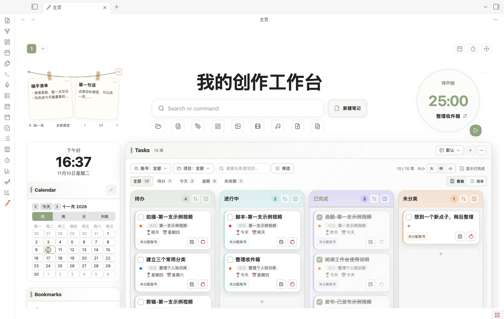
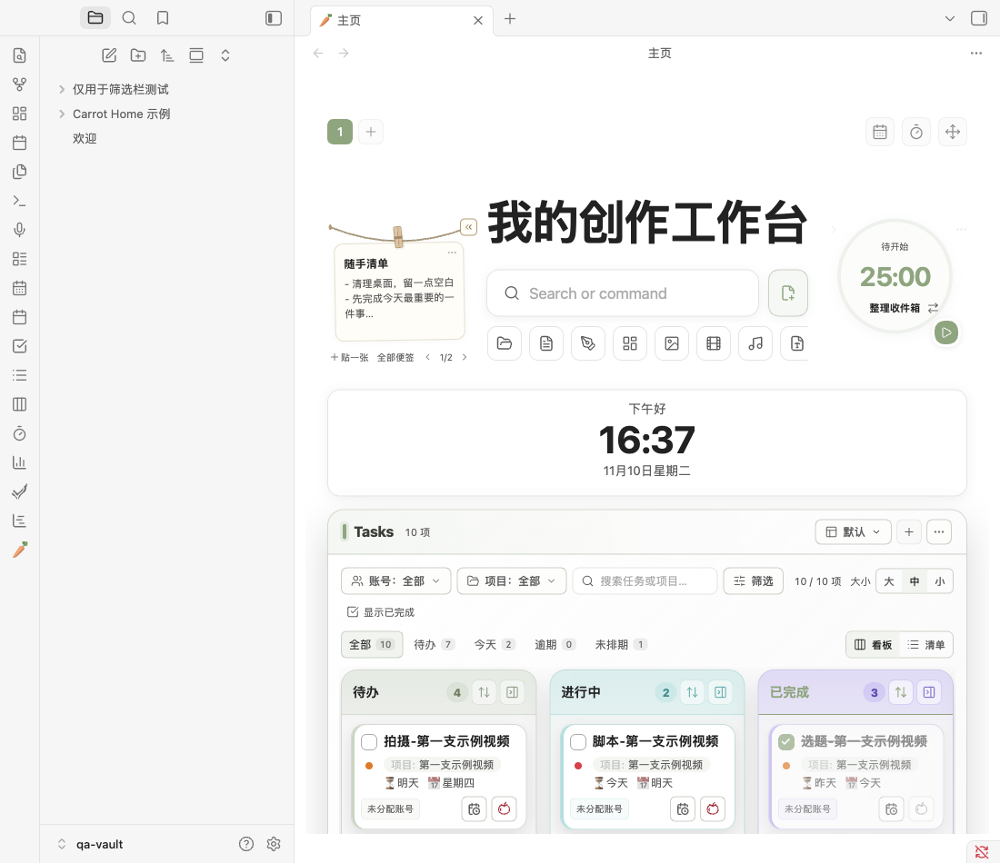
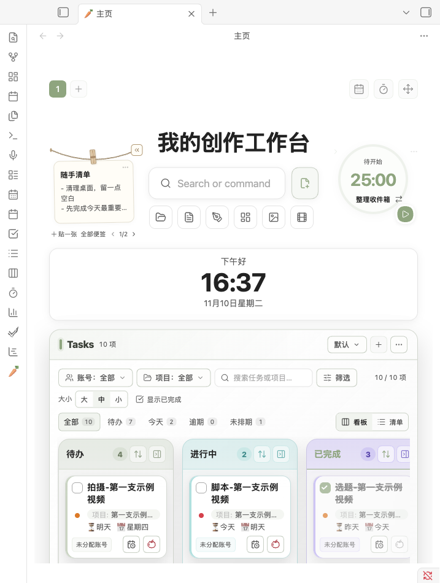

Carrot Home 2.1.4 优化笔记本与侧边栏场景下的顶部布局，让便签、搜索和专注圆盘协调缩放。

- **两侧更晚退场**：下方卡片在720px可用宽度进入单列后，两侧工具继续保留，到600px才切为紧凑入口。
- **中间同步收窄**：标题、搜索、新建笔记与分类栏按空间调整。新建按钮适时只显示图标，分类保持方形，可横向滚动。
- **视觉重心稳定**：专注圆盘以圆心定位，缩小后不再向上漂移；左侧晾绳、木夹与绳端按钮构成的图案最上沿，与右侧圆盘上沿对齐。
- **折叠位置稳定**：两侧收起/展开、收起后重载均保留状态与位置；不更改TaskNotes计时服务逻辑、已有卡片布局设置或便签原文。

### 宽屏

### 打开侧边栏

### 下方单列后顶部仍保留

图片均为独立Obsidian演示库中的实际插件界面，只含虚构内容。

升级前备份插件目录，只替换 `main.js`、`manifest.json`、`styles.css` 并重载Carrot Home；保留 `data.json`、`top-area.json`、所有Markdown与备份，无需重启TaskNotes。

103项自动化测试通过。独立Obsidian桌面环境验证响应式断点、九个分类按钮滚动与点击、中文搜索、便签管理、两侧折叠/展开及折叠后重载。未重新验收完整番茄工作/休息周期、系统休眠与移动端真机。
